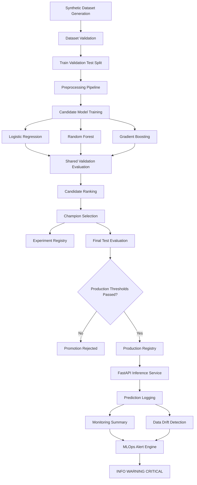

# AI Model Operations Center

[](https://www.python.org/)
[](https://fastapi.tiangolo.com/)
[](https://www.docker.com/)
[](#testing)

An end-to-end MLOps platform for generating and validating data, training multiple machine learning candidates, selecting and promoting a champion model, serving predictions through FastAPI, and monitoring production behavior through drift detection and automated alerts.

---

## Overview

AI Model Operations Center demonstrates the complete lifecycle of a supervised machine learning system.

The project covers:

- synthetic dataset generation;
- data quality validation;
- train, validation, and test splitting;
- preprocessing and feature transformation;
- baseline model training;
- candidate model comparison;
- automatic champion selection;
- experiment tracking;
- final test-set evaluation;
- production model promotion;
- inference through a REST API;
- prediction logging;
- operational monitoring;
- data drift detection;
- automated MLOps alerts;
- Docker containerization;
- unit and integration testing.

The project is designed as a portfolio-ready example of production-oriented machine learning engineering.

---

## Problem Statement

A machine learning model is not complete when training finishes.

A production-ready machine learning system must also answer the following questions:

- Are the input data valid?
- Which model performs best under the same evaluation conditions?
- Does the selected model satisfy mandatory business thresholds?
- Which model version is currently active?
- Can every experiment be reproduced and inspected?
- Is the production API healthy?
- Are predictions becoming slower or less confident?
- Are production inputs drifting away from the training distribution?
- Should the engineering team receive an operational alert?

AI Model Operations Center implements these capabilities in one modular and testable platform.

---

## Key Features

### Data generation and validation

- Reproducible synthetic dataset generation
- Configurable class distribution
- Pydantic-based configuration validation
- Dataset schema validation
- Missing-value and data-type controls
- Deterministic random seeds

### Training pipeline

- Train, validation, and test separation
- Reusable preprocessing pipeline
- Persisted preprocessing artifacts
- Baseline model training
- Shared evaluation logic
- Configurable quality thresholds

### Candidate model comparison

The platform can train and compare multiple candidate models:

- Logistic Regression
- Random Forest
- Gradient Boosting

Candidates are ranked according to:

1. validation status;
2. macro F1 score;
3. recall for the `POOR` class;
4. prediction latency;
5. training duration.

A rejected model cannot become champion, even if one of its individual metrics is high.

### Experiment registry

Each candidate experiment records:

- unique experiment identifier;
- creation and completion timestamps;
- experiment status;
- random seed;
- dataset reference;
- candidate metrics;
- selected champion;
- generated artifacts;
- error details when an execution fails.

### Production promotion

The selected champion is evaluated once on the isolated test set.

The model is promoted only when it satisfies the configured production thresholds.

Production artifacts include:

- trained model;
- fitted preprocessor;
- production metadata;
- production registry;
- final test metrics;
- confusion matrix.

### FastAPI inference

The production model is exposed through a REST API.

Main endpoints:

```text
GET  /
GET  /api/v1/health
GET  /api/v1/model
POST /api/v1/predict
```

### Monitoring

Every prediction can be logged with:

- prediction identifier;
- timestamp;
- predicted class;
- confidence;
- model name and version;
- input features;
- request latency;
- success status;
- error message.

Monitoring endpoints:

```text
GET /api/v1/monitoring/summary
GET /api/v1/monitoring/predictions
```

### Data drift detection

The project compares reference data with production inputs using:

- reference and production means;
- reference standard deviation;
- normalized mean difference;
- Population Stability Index;
- per-feature drift status;
- global drift status.

Supported statuses:

```text
STABLE
WARNING
DRIFTED
INSUFFICIENT_DATA
```

Drift endpoints:

```text
GET  /api/v1/monitoring/drift
POST /api/v1/monitoring/drift/report
```

### MLOps alerts

The alert engine evaluates:

- prediction failure rate;
- average prediction confidence;
- average latency;
- global data drift status.

Alert severities:

```text
INFO
WARNING
CRITICAL
```

Alert endpoints:

```text
GET  /api/v1/monitoring/alerts
POST /api/v1/monitoring/alerts/evaluate
```

---

## Architecture



---

## Machine Learning Lifecycle

```text
Dataset generation
        ↓
Dataset validation
        ↓
Train / validation / test split
        ↓
Preprocessor training
        ↓
Candidate model training
        ↓
Validation-set comparison
        ↓
Champion selection
        ↓
Experiment registration
        ↓
Final test-set evaluation
        ↓
Production promotion
        ↓
FastAPI inference
        ↓
Prediction monitoring
        ↓
Drift detection
        ↓
MLOps alerts
```

### Dataset usage policy

The three data subsets have distinct responsibilities:

```text
Training set
→ model fitting

Validation set
→ candidate comparison and champion selection

Test set
→ one-time final evaluation before production promotion
```

The test set is not used for hyperparameter selection.

---

## Project Structure

```text
ai-model-operations-center/
├── app/
│   ├── api/
│   │   └── routes/
│   │       ├── inference.py
│   │       └── monitoring.py
│   ├── core/
│   │   ├── alert_schemas.py
│   │   ├── candidate_config.py
│   │   ├── candidate_schemas.py
│   │   ├── drift_schemas.py
│   │   ├── experiment_registry.py
│   │   ├── inference_schemas.py
│   │   ├── monitoring_config.py
│   │   ├── monitoring_schemas.py
│   │   ├── promotion_config.py
│   │   ├── promotion_schemas.py
│   │   ├── registry_schemas.py
│   │   └── training_schemas.py
│   ├── services/
│   │   ├── alert_service.py
│   │   ├── drift_detector.py
│   │   ├── inference_service.py
│   │   └── prediction_logger.py
│   └── main.py
├── config/
│   ├── candidate_models.yaml
│   ├── monitoring.yaml
│   └── promotion.yaml
├── data/
│   ├── raw/
│   ├── processed/
│   └── monitoring/
├── models/
│   ├── candidates/
│   ├── preprocessing/
│   ├── production/
│   └── registry/
├── pipelines/
│   ├── prepare_training_data.py
│   ├── train_candidates.py
│   ├── run_candidate_experiment.py
│   └── promote_champion.py
├── reports/
│   ├── drift/
│   └── evaluation/
├── tests/
│   ├── unit/
│   └── integration/
├── .dockerignore
├── .gitignore
├── compose.yaml
├── Dockerfile
├── pyproject.toml
├── requirements.txt
├── requirements-dev.txt
└── README.md
```

Generated datasets, model binaries, prediction logs, and runtime reports are intentionally excluded from version control.

---

## Technology Stack

### Core development

- Python 3.13
- Pydantic
- PyYAML
- pandas
- NumPy

### Machine learning

- scikit-learn
- joblib

### API

- FastAPI
- Uvicorn

### Testing

- Pytest
- Pytest Coverage
- FastAPI TestClient

### Deployment

- Docker
- Docker Compose
- GitHub Actions

---

## Installation

### 1. Clone the repository

```powershell
git clone https://github.com/ImadeddineAklouf/ai-model-operations-center.git
```

```powershell
cd ai-model-operations-center
```

### 2. Create a virtual environment

```powershell
python -m venv .venv
```

### 3. Activate the environment on Windows

```powershell
.\.venv\Scripts\Activate.ps1
```

### 4. Install the dependencies

```powershell
python -m pip install --upgrade pip
```

```powershell
python -m pip install -r requirements-dev.txt
```

---

## Running the Complete ML Workflow

The generated runtime artifacts are not stored in Git. They must be recreated locally.

### 1. Generate or provide the dataset

Place the source dataset in:

```text
data/raw/
```

The expected target column is:

```text
quality_label
```

The supported labels are:

```text
GOOD
ACCEPTABLE
POOR
```

### 2. Prepare the training data

```powershell
python -m pipelines.prepare_training_data
```

This step generates the isolated training, validation, and test datasets and the preprocessing artifacts.

### 3. Run the candidate experiment

```powershell
python -m pipelines.run_candidate_experiment
```

This step:

- trains all enabled candidate models;
- evaluates the candidates on the validation set;
- ranks the candidates;
- selects a champion;
- stores the experiment in the local registry.

### 4. Promote the champion

```powershell
python -m pipelines.promote_champion
```

This step:

- loads the selected champion;
- evaluates the model on the isolated test set;
- verifies the production thresholds;
- promotes the model when all requirements are satisfied.

---

## Configuration

The project uses YAML configuration files validated with Pydantic.

### Candidate models

```text
config/candidate_models.yaml
```

Controls:

- enabled candidate models;
- model versions;
- hyperparameters;
- validation thresholds;
- input directories;
- output directories.

### Production promotion

```text
config/promotion.yaml
```

Controls:

- champion descriptor;
- test-set locations;
- source model directory;
- preprocessor location;
- production thresholds;
- production artifact directories.

### Monitoring

```text
config/monitoring.yaml
```

Controls:

- prediction log directory;
- reference dataset;
- minimum production sample size;
- PSI warning and drift thresholds;
- histogram bin count;
- latency thresholds;
- confidence thresholds;
- failure-rate thresholds;
- alert output directory.

---

## Starting the API

After promoting a production model:

```powershell
python -m uvicorn app.main:app --host 127.0.0.1 --port 8000 --reload
```

The API is available at:

```text
http://127.0.0.1:8000
```

Interactive Swagger documentation:

```text
http://127.0.0.1:8000/docs
```

ReDoc documentation:

```text
http://127.0.0.1:8000/redoc
```

---

## API Endpoints

### Service information

```http
GET /
```

Returns the service status and links to the principal endpoints.

### Health

```http
GET /api/v1/health
```

Example response:

```json
{
  "status": "healthy",
  "model_loaded": true,
  "preprocessor_loaded": true
}
```

### Production model information

```http
GET /api/v1/model
```

Example response:

```json
{
  "model_name": "random_forest",
  "model_version": "1.0.0",
  "status": "ACTIVE",
  "promoted_at": "2026-10-14T08:00:00+00:00",
  "evaluated_split": "test",
  "accuracy": 0.95,
  "f1_macro": 0.94,
  "poor_recall": 0.96
}
```

The values above illustrate the response structure. The actual values are read from the local production registry.

### Prediction

```http
POST /api/v1/predict
```

Example request:

```json
{
  "row_count": 20000,
  "column_count": 18,
  "missing_value_ratio": 0.08,
  "duplicate_row_ratio": 0.03,
  "invalid_type_ratio": 0.02,
  "primary_key_uniqueness": 0.97,
  "foreign_key_match_ratio": 0.94,
  "schema_change_count": 1,
  "outlier_ratio": 0.05,
  "freshness_delay_hours": 10.0
}
```

Example response:

```json
{
  "prediction": "ACCEPTABLE",
  "confidence": 0.87,
  "probabilities": {
    "ACCEPTABLE": 0.87,
    "GOOD": 0.1,
    "POOR": 0.03
  },
  "model_name": "random_forest",
  "model_version": "1.0.0"
}
```

The prediction and probability values depend on the promoted model.

---

## Monitoring Endpoints

### Monitoring summary

```http
GET /api/v1/monitoring/summary
```

Returns:

- total prediction count;
- successful prediction count;
- failed prediction count;
- success rate;
- average confidence;
- average latency;
- prediction distribution;
- model version distribution.

### Prediction history

```http
GET /api/v1/monitoring/predictions?limit=100
```

Returns the latest prediction records.

The `limit` parameter must be between `1` and `1000`.

### Real-time drift analysis

```http
GET /api/v1/monitoring/drift
```

Returns the current drift report without writing it to disk.

### Generate and save a drift report

```http
POST /api/v1/monitoring/drift/report
```

Generates and stores:

```text
reports/drift/drift_report.json
```

### Latest alert report

```http
GET /api/v1/monitoring/alerts
```

Returns the latest alert report, or `null` if no report has been generated.

### Evaluate the MLOps alerts

```http
POST /api/v1/monitoring/alerts/evaluate
```

Evaluates:

- failure rate;
- average confidence;
- average latency;
- data drift.

---

## Data Drift Detection

The project uses the Population Stability Index to compare the reference dataset with production requests.

Typical interpretation:

```text
PSI < 0.10
→ STABLE

0.10 ≤ PSI < 0.25
→ WARNING

PSI ≥ 0.25
→ DRIFTED
```

The exact thresholds are configurable in:

```text
config/monitoring.yaml
```

A minimum number of production records is required before drift analysis is considered statistically meaningful.

Until this minimum is reached, the status is:

```text
INSUFFICIENT_DATA
```

---

## MLOps Alerts

The alert engine can generate alerts in the following categories:

```text
PREDICTION_FAILURE_RATE
LOW_CONFIDENCE
HIGH_LATENCY
DATA_DRIFT
```

Supported severities:

```text
INFO
WARNING
CRITICAL
```

The global report severity is determined by the highest active alert severity.

Alert thresholds are configured in:

```text
config/monitoring.yaml
```

---

## Docker

### Build the public image

```powershell
docker build --tag ai-model-operations-center:latest .
```

### Run with persistent local artifacts

```powershell
$projectRoot = (Get-Location).Path
```

```powershell
docker run `
    --detach `
    --name "ai-model-operations-center" `
    --publish "8000:8000" `
    --mount "type=bind,source=$projectRoot\models\production,target=/app/models/production,readonly" `
    --mount "type=bind,source=$projectRoot\data\raw,target=/app/data/raw,readonly" `
    --mount "type=bind,source=$projectRoot\data\monitoring,target=/app/data/monitoring" `
    --mount "type=bind,source=$projectRoot\reports\drift,target=/app/reports/drift" `
    "ai-model-operations-center:latest"
```

### Check the container health

```powershell
docker inspect `
    "ai-model-operations-center" `
    --format "{{.State.Health.Status}}"
```

Expected result:

```text
healthy
```

### View the logs

```powershell
docker logs --tail 100 "ai-model-operations-center"
```

### Stop the container

```powershell
docker stop "ai-model-operations-center"
```

### Remove the container

```powershell
docker rm "ai-model-operations-center"
```

---

## Docker Compose

Start the service:

```powershell
docker compose up --build --detach
```

View the logs:

```powershell
docker compose logs --follow
```

Stop the service:

```powershell
docker compose down
```

The Compose configuration mounts the generated model, reference data, monitoring logs, and drift reports as external volumes.

---

## Corporate Network Note

Some enterprise networks perform HTTPS inspection through a corporate certificate authority.

In that situation:

- keep the public `Dockerfile` unchanged;
- install the corporate certificate only in a local Dockerfile;
- never commit internal certificates;
- never disable TLS verification;
- never add credentials to the Docker image.

Local certificates and corporate Docker configuration are excluded from version control.

---

## Testing

Run the complete test suite:

```powershell
python -m pytest -q --cache-clear
```

Run unit tests:

```powershell
python -m pytest tests/unit -v
```

Run integration tests:

```powershell
python -m pytest tests/integration -v
```

Run tests with coverage:

```powershell
python -m pytest `
    --cov=app `
    --cov=pipelines `
    --cov-report=term-missing `
    --cov-report=html
```

The HTML coverage report is generated in:

```text
htmlcov/index.html
```

The project includes extensive unit and integration coverage for:

- schemas;
- configuration loaders;
- dataset preparation;
- candidate promotion;
- inference service;
- FastAPI routes;
- prediction logging;
- monitoring;
- drift detection;
- alert evaluation.

---

## Model Evaluation

The project evaluates candidate and production models using:

- accuracy;
- macro precision;
- macro recall;
- macro F1;
- recall for the `POOR` class;
- prediction latency;
- training duration;
- confusion matrix.

The final production results are stored locally in:

```text
models/production/registry.json
reports/evaluation/production/test_metrics.json
reports/evaluation/production/confusion_matrix.csv
```

These runtime files are intentionally excluded from Git.

---

## Reproducibility

The project supports reproducible experiments through:

- deterministic random seeds;
- YAML configurations;
- validated Pydantic schemas;
- persisted preprocessing artifacts;
- experiment identifiers;
- model version tracking;
- isolated train, validation, and test sets;
- explicit production thresholds;
- automated tests.

For full reproducibility, dependency versions should remain pinned in `requirements.txt`.

---

## Security and Privacy

The public repository does not contain:

- production datasets;
- private documents;
- authentication tokens;
- passwords;
- internal URLs;
- corporate proxy credentials;
- private certificates;
- trained binary artifacts;
- prediction histories.

Generated data and model artifacts are excluded through `.gitignore`.

The Docker container runs with a non-root system user.

---

## Design Principles

The project follows several engineering principles:

```text
One module
→ one clear responsibility

One service
→ independently testable behavior

One pipeline
→ integration test coverage

Every configuration
→ YAML plus Pydantic validation

Every experiment
→ unique identifier and registry entry

Every production model
→ explicit version and evaluation report

Every prediction
→ observable latency, confidence, and status

Every monitoring signal
→ structured and actionable output
```

---

## Limitations

This project is a portfolio-oriented MLOps implementation.

Current limitations include:

- local filesystem-based registry;
- local JSONL monitoring storage;
- no external authentication provider;
- no distributed task queue;
- no centralized observability platform;
- no cloud model registry;
- no automated retraining scheduler.

These components can be introduced in a larger production deployment.

---

## Future Improvements

Potential future developments:

- MLflow experiment tracking;
- PostgreSQL-backed prediction history;
- Prometheus metrics;
- Grafana dashboards;
- OpenTelemetry tracing;
- scheduled drift analysis;
- automatic retraining triggers;
- canary model deployment;
- champion versus challenger evaluation;
- API authentication;
- request rate limiting;
- Kubernetes deployment;
- cloud object storage;
- centralized model registry.

---

## Portfolio Context

AI Model Operations Center demonstrates skills in:

- machine learning engineering;
- MLOps architecture;
- model lifecycle management;
- API development;
- software testing;
- data validation;
- production monitoring;
- drift detection;
- containerization;
- configuration management.

The project complements other work focused on semantic layer generation, data intelligence, and agent-based AI systems.

---

## License

This project is available under the terms defined in the LICENSE file.

---

## Author

**Imadeddine Aklouf**

GitHub: [github.com/ImadeddineAklouf](https://github.com/ImadeddineAklouf)

Project repository:  
[github.com/ImadeddineAklouf/ai-model-operations-center](https://github.com/ImadeddineAklouf/ai-model-operations-center)
